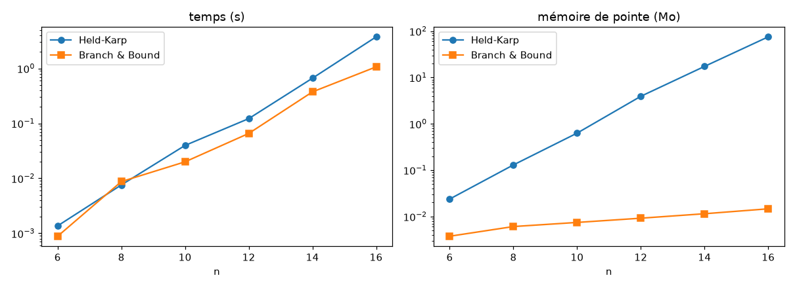

# Journal d'expériences — Médina 2.0

Graine G = 7952  ·  k = 99

> Tableaux et courbes générés automatiquement par `experiences.py`. Voir `ANALYSES.md` pour les interprétations.

## Bonus — Branch and Bound vs Held-Karp

| n | HK temps (ms) | HK mémoire (Mo) | B&B temps (ms) | B&B mémoire (Mo) | B&B nœuds | HK états |
|---|---|---|---|---|---|---|
| 6 | 1.4 | 0.02 | 0.9 | 0.004 | 24 | 80 |
| 8 | 7.6 | 0.13 | 8.7 | 0.006 | 222 | 448 |
| 10 | 39.7 | 0.63 | 20.0 | 0.007 | 829 | 2304 |
| 12 | 122.1 | 3.92 | 65.6 | 0.009 | 2625 | 11264 |
| 14 | 663.8 | 17.34 | 374.2 | 0.011 | 12555 | 53248 |
| 16 | 3752.6 | 75.25 | 1067.5 | 0.015 | 25856 | 245760 |

