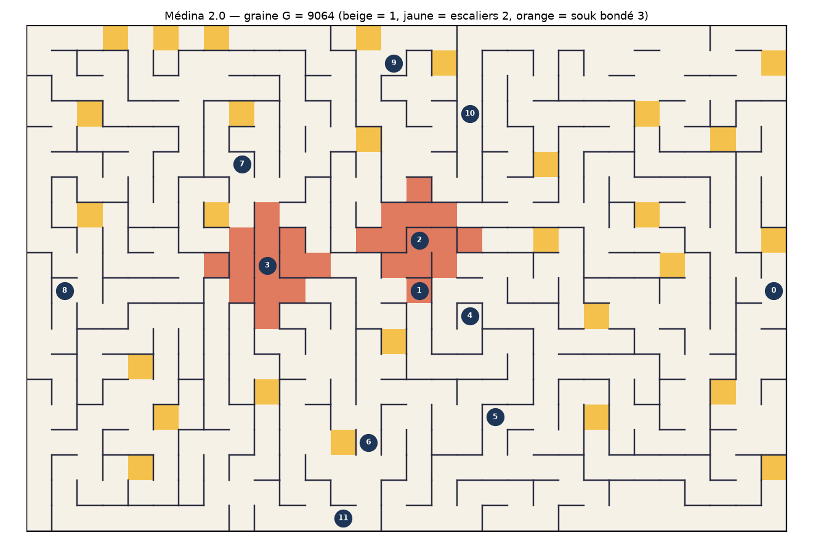
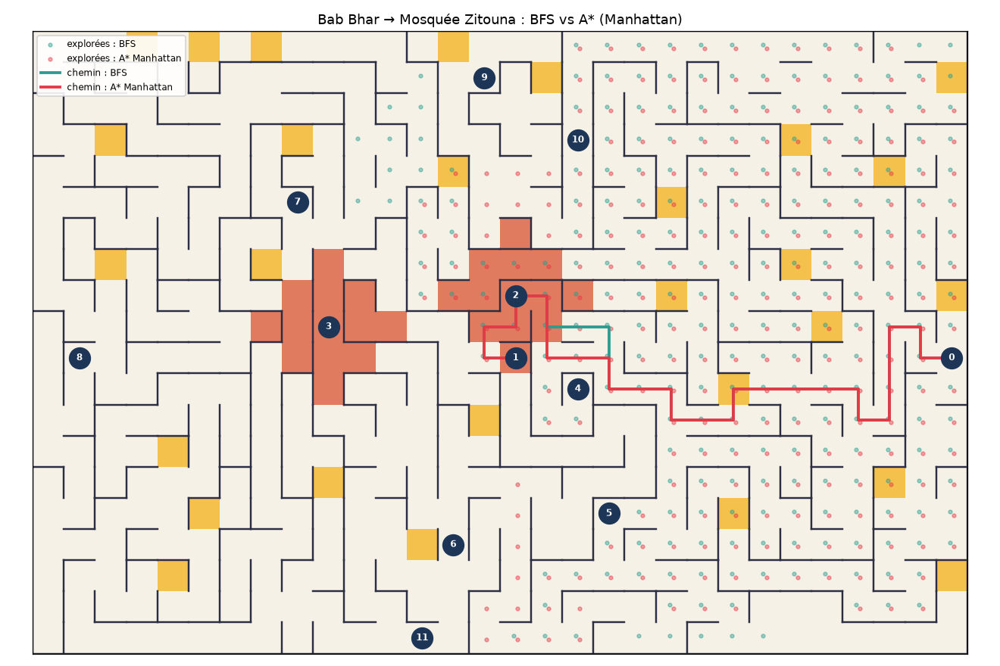
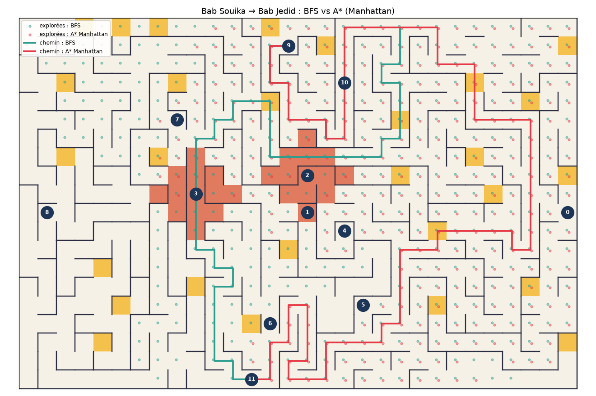
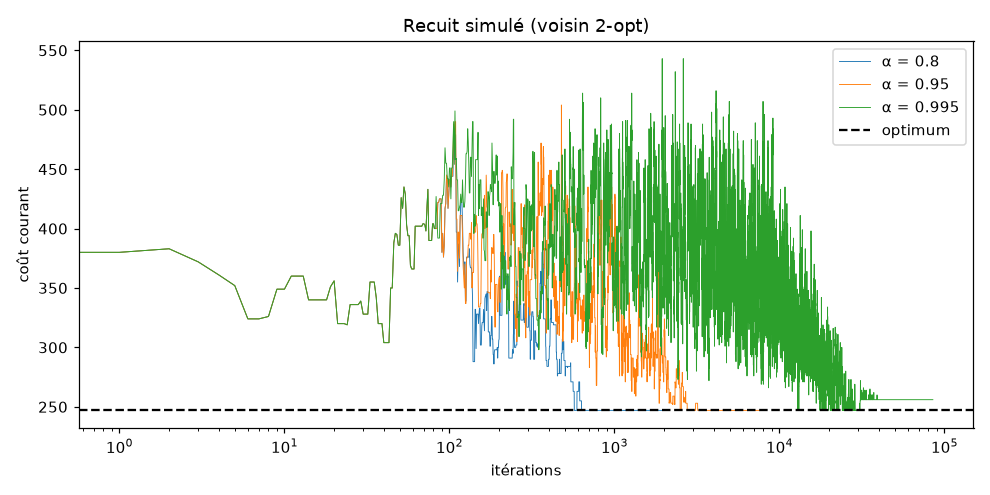
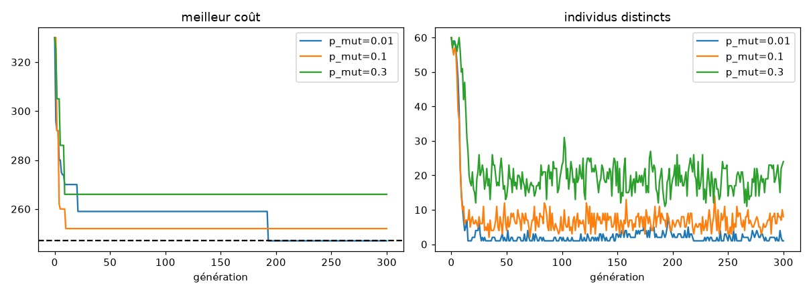

# Journal d'expériences — Médina 2.0

Graine G = 9064  ·  k = 63

> Tableaux et courbes générés automatiquement par `experiences.py`. Voir `ANALYSES.md` pour les interprétations.

## Partie 1 — La carte

- Graine G = 9064, k = 60 + (G mod 41) = 63
- Passages du labyrinthe parfait : 599 (attendu P×Q−1 = 599)
- Passages après ouverture : 662 (= 599 + 63)
- Escaliers : 28 cases



## Partie 2 — Le touriste perdu

### Q6b — Contre-exemples BFS (pas minimal ≠ coût minimal)

33 paires de points d'intérêt sur 132 où BFS est strictement plus cher que le coût uniforme. Exemples :

| trajet | BFS : pas | BFS : coût | UCS : pas | UCS : coût |
|---|---|---|---|---|
| 0→6 | 36 | 48 | 38 | 39 |
| 0→11 | 40 | 52 | 40 | 41 |
| 1→5 | 18 | 28 | 24 | 25 |
| 2→9 | 56 | 72 | 56 | 62 |
| 2→10 | 43 | 59 | 43 | 49 |

### Q7 — DFS vs BFS : labyrinthe parfait (k=0) vs Médina (k>0)

| carte | trajet | pas BFS | pas DFS | coût BFS | coût DFS |
|---|---|---|---|---|---|
| parfait k=0 | 0→1 | 96 | 96 | 113 | 113 |
| parfait k=0 | 9→11 | 138 | 138 | 149 | 149 |
| Médina k=63 | 0→1 | 28 | 86 | 41 | 102 |
| Médina k=63 | 9→11 | 62 | 180 | 80 | 206 |

### Q11 — Trajet Bab Bhar (0) → Mosquée Zitouna (1)

| Méthode | Nombre de pas | Coût | Cases explorées | Optimal en coût ? | Temps (ms) |
|---|---|---|---|---|---|
| BFS | 28 | 41 | 272 | oui | 0.74 |
| DFS | 86 | 102 | 135 | non | 0.33 |
| Coût uniforme | 28 | 41 | 361 | oui | 1.03 |
| Glouton (Manhattan) | 30 | 43 | 40 | non | 0.13 |
| A* (h nulle) | 28 | 41 | 361 | oui | 1.11 |
| A* (Tchebychev) | 28 | 41 | 293 | oui | 0.90 |
| A* (Euclide) | 28 | 41 | 287 | oui | 0.91 |
| A* (Manhattan) | 28 | 41 | 270 | oui | 0.83 |
| A* pondéré (Manhattan, w=2) | 28 | 41 | 142 | oui | 0.50 |



### Q11 — Trajet Bab Souika (9) → Bab Jedid (11)

| Méthode | Nombre de pas | Coût | Cases explorées | Optimal en coût ? | Temps (ms) |
|---|---|---|---|---|---|
| BFS | 62 | 80 | 475 | non | 1.28 |
| DFS | 180 | 206 | 479 | non | 1.15 |
| Coût uniforme | 72 | 74 | 488 | oui | 1.39 |
| Glouton (Manhattan) | 62 | 81 | 87 | non | 0.25 |
| A* (h nulle) | 72 | 74 | 488 | oui | 1.55 |
| A* (Tchebychev) | 72 | 74 | 378 | oui | 1.17 |
| A* (Euclide) | 72 | 74 | 361 | oui | 1.14 |
| A* (Manhattan) | 72 | 74 | 346 | oui | 1.15 |
| A* pondéré (Manhattan, w=2) | 64 | 77 | 153 | non | 0.48 |



## Partie 3 — Le circuit du guide

### Q12 — Matrice des coûts (132 appels à A*, 77 ms)

```
  0  41  31  47  26  21  39  40  66  39  26  41
 39   0  10  19  21  25  11  16  43  66  53  15
 29  10   0  25  11  18  17  22  49  62  49  21
 45  19  25   0  36  31  15   9  41  59  46  19
 26  23  13  38   0  15  30  35  62  59  46  34
 21  27  20  33  15   0  18  37  48  54  41  20
 39  13  19  17  30  18   0  23  32  72  59   4
 40  18  24  11  35  37  23   0  36  54  41  27
 66  45  51  43  62  48  32  36   0  80  67  28
 39  68  64  61  59  54  72  54  80   0  13  74
 26  55  51  48  46  41  59  41  67  13   0  61
 41  17  23  21  34  20   4  27  28  74  61   0
```

Paires (i,j) asymétriques : 27/66. Relation vérifiée `M[i][j] − M[j][i] = cout(j) − cout(i)` pour toutes les paires : **True**.

### Q13-Q14 — Référence

- Plus proche voisin : [0, 5, 4, 2, 1, 6, 11, 3, 7, 8, 10, 9], coût 259
- Held-Karp : coût **247**, tournée [0, 10, 9, 7, 3, 8, 11, 6, 1, 2, 4, 5], 11264 états, 38 ms

### Q15 — Descente 2-opt depuis 10 tournées aléatoires

Coûts atteints : [252, 256, 247, 247, 256, 256, 247, 256, 253, 247] (optimum 247) → optimum atteint 4/10 fois.

### Q16 — Recuit simulé (T0=50, palier=50, 10 graines)

| voisinage | α | itérations | meilleur coût | coût moyen | pire coût |
|---|---|---|---|---|---|
| échange | 0.8 | 1951 | 247 | 257.3 | 271 |
| échange | 0.95 | 8351 | 247 | 250.7 | 268 |
| échange | 0.995 | 85001 | 247 | 247.0 | 247 |
| 2-opt | 0.8 | 1951 | 247 | 249.7 | 256 |
| 2-opt | 0.95 | 8351 | 247 | 247.0 | 247 |
| 2-opt | 0.995 | 85001 | 247 | 247.0 | 247 |



### Q17 — Algorithme génétique (pop 60, 300 gén., tournoi 3, élite 2)

| p_mut | meilleur coût | coût moyen | pire coût | diversité finale (graine G) |
|---|---|---|---|---|
| 0.01 | 247 | 255.8 | 285 | 1 |
| 0.1 | 247 | 253.7 | 272 | 7 |
| 0.3 | 247 | 258.8 | 268 | 20 |



### Q18 — Comparaison finale (10 graines G … G+9)

| Méthode | Écart moyen (%) | Meilleur écart (%) | Pire écart (%) | Temps moyen (ms) |
|---|---|---|---|---|
| Plus proche voisin | 4.86 | 4.86 | 4.86 | 0.0 |
| Descente 2-opt (départ aléatoire) | 2.23 | 0.00 | 3.64 | 0.9 |
| Recuit simulé (échange, α=0.995) | 0.00 | 0.00 | 0.00 | 509.6 |
| Algorithme génétique (p_mut=0.1) | 2.71 | 0.00 | 10.12 | 267.0 |
| Held-Karp | 0.00 | 0.00 | 0.00 | 37.4 |

## Partie 4 — Le souk réaménagé

### Q19 — Force brute

10 emplacements pour 8 artisans : 10⁸ affectations sans tenir compte de « tous différents », 10!/2! = 1 814 400 affectations injectives.

### Q20-Q21 — 82 solutions au total

| Variante | Nœuds (1re sol.) | Retours (1re sol.) | Temps (ms) | Nœuds (toutes) | Retours (toutes) |
|---|---|---|---|---|---|
| Backtracking simple | 10 | 1 | 0.20 | 260 | 93 |
| + MRV et degré | 9 | 0 | 0.92 | 344 | 111 |
| + forward checking | 9 | 1 | 0.35 | 187 | 93 |
| + MRV, degré et forward checking | 9 | 0 | 0.77 | 265 | 111 |
| AC-3 puis MRV, degré et forward checking | 9 | 0 | 0.98 | 265 | 110 |

Première solution : {'PA': 1, 'PB': 3, 'CH': 2, 'DI': 7, 'BI': 5, 'TI': 4, 'LI': 8, 'PT': 9}

### Q22 — Domaines avant / après AC-3

| variable | avant | après |
|---|---|---|
| PA | 3 valeurs | [1, 3] |
| PB | 3 valeurs | [1, 3] |
| CH | 10 valeurs | [1, 2, 3, 4, 5, 6, 7, 8, 9, 10] |
| DI | 7 valeurs | [5, 6, 7] |
| BI | 10 valeurs | [1, 2, 3, 4, 5, 6, 7, 8, 9, 10] |
| TI | 10 valeurs | [1, 2, 3, 4, 5, 6, 7, 8, 9, 10] |
| LI | 3 valeurs | [8, 9, 10] |
| PT | 10 valeurs | [1, 2, 3, 4, 5, 7, 8, 9, 10] |

### Q23 — La contrainte de trop

- AC-3 seul renvoie **True** (il ne détecte pas l'impossibilité)
- Backtracking : 0 solution, 18 nœuds, 17 retours

## Partie 5 — La Kharbga

Position de milieu de partie (8 demi-coups aléatoires, graine G) :

```
   0 1 2 3 4
0  ● · ● ● ●
1  ● ● ● ● ·
2  ● · · ○ ●
3  ○ ○ ○ ○ ○
4  ○ ○ ○ · ○
```

### Q26-Q27 — Nœuds explorés (eval_1)

| Profondeur | Nœuds Minimax | Nœuds alpha-bêta | Nœuds alpha-bêta + ordre (Q27) | Temps alpha-bêta (ms) |
|---|---|---|---|---|
| 1 | 7 | 7 | 7 | 0.1 |
| 2 | 59 | 22 | 22 | 0.4 |
| 3 | 430 | 75 | 67 | 1.0 |
| 4 | 3467 | 306 | 254 | 3.3 |
| 5 | 24248 | 853 | 668 | 10.2 |

Vérification : alpha-bêta = Minimax (profondeur 3, eval_1 et eval_2) sur 20/20 positions.

### Q28 — Tournoi eval_1 vs eval_2 (10 parties, profondeur 3, 7 s)

Score : **eval_1 = 5.0**, **eval_2 = 5.0**

| partie | Blancs | résultat | pions eval_2 − eval_1 |
|---|---|---|---|
| 1 | eval_1 | nul | 0 |
| 2 | eval_2 | nul | 1 |
| 3 | eval_1 | nul | 2 |
| 4 | eval_2 | nul | 0 |
| 5 | eval_1 | nul | 2 |
| 6 | eval_2 | nul | 1 |
| 7 | eval_1 | nul | 0 |
| 8 | eval_2 | nul | 0 |
| 9 | eval_1 | nul | 2 |
| 10 | eval_2 | nul | 0 |

